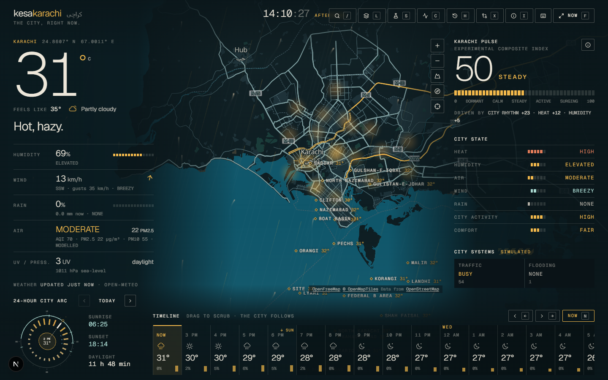
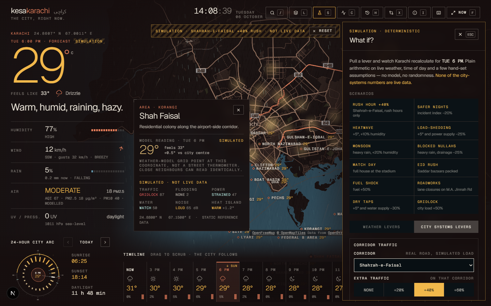
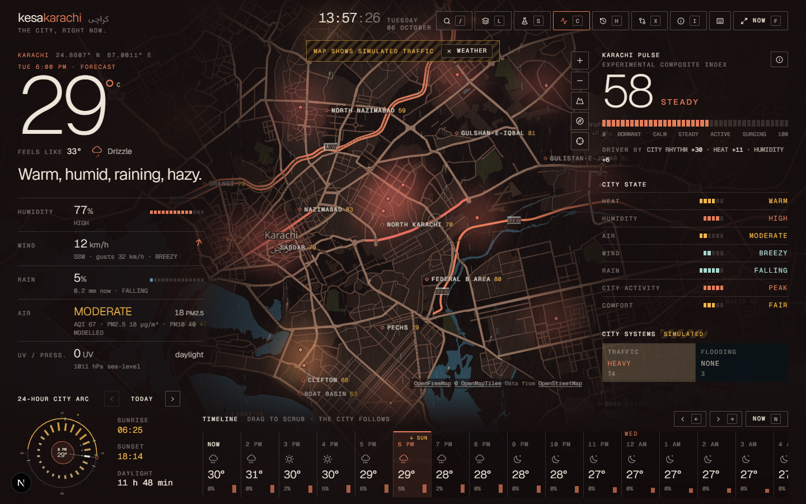

# kesakarachi

**A living interface for Karachi.** One screen that answers *"what is Karachi doing right now?"* — real weather and modelled air quality drawn over the city, a deterministic *city state* calculated from them, and a simulation engine for asking *what if*.

**Live demo:** add your Vercel URL here after the first deploy (see [Deployment](#deployment)) · Demo video: *coming soon*



## What is this?

A browser-only operating-system-style view of one city. The map is the interface: weather, air, prayer times, neighbourhoods and landmarks sit directly on it, the whole UI re-tints with Karachi's light (dawn → night), and you can scrub through the next 72 hours and watch everything — the map, the numbers, the sky — follow.

It is built around one rule: **never pretend.** Every number on screen is one of three things, and it says which:

| Label | Meaning | Examples |
|---|---|---|
| **LIVE / MODEL** | Real data from a public source, with its age shown | weather, modelled air quality, prayer times, ten years of archive weather |
| **STATIC REFERENCE** | Hand-curated geography | neighbourhoods, landmarks, corridors |
| **SIMULATION** | A deterministic model or lever, never presented as a reading | traffic, flooding, power, water, transit, noise, heat islands, events, the *What if?* layer |

## Why I built it

Weather apps answer "do I need an umbrella". They don't answer what the city *feels* like: that a 34° afternoon with 71% humidity and a sea breeze is a different day from 34° with still air; that the same rain means something different on Korangi Road than in DHA. I wanted to see Karachi as one system — and to be able to push on it. *What if we raise traffic 40% at rush hour on Shahrah-e-Faisal? What if nullahs are blocked in a monsoon? What if incidents drop 20%?*

There are no free live feeds for Karachi's traffic, floods, power or water. Rather than fake them, or leave them out, the simulation engine models them from real weather + time of day + a few explicit assumptions, labels every output SIMULATION, and documents every rule.

## Features

**Live**
- Current conditions and a 72-hour timeline: temperature, feels-like, humidity, wind (with direction), rain chance, UV, pressure, sunrise/sunset (Open-Meteo)
- **Modelled air quality**: US AQI, PM2.5/PM10 vs WHO guidelines, NO₂, O₃, SO₂, CO, dust, 48-hour outlook. Labelled *modelled* everywhere — it is a CAMS model, not a station reading
- Prayer times (University of Islamic Sciences, Karachi method) and a next-prayer countdown
- **This date in the record**: today's forecast against the same date in the last ten years (ERA5 archive), plus the last 30 days
- Per-neighbourhood temperatures (the weather model sampled at each coordinate), mapped as a heat field

**The interface**
- **Karachi Pulse** — an experimental 0–100 composite of weather, air, time of day and assumed city rhythm, with the full formula in the app
- **City State** — heat, humidity, air, wind, rain, activity, comfort, from transparent threshold tables
- **24-hour city arc** — a radial dial of the day: sunrise → sunset, temperature bars, rain ticks, the pulse line, prayer ticks; drag the hand and the city moves in time
- **Time-of-day theming** — six phases (dawn → night) change the UI palette *and* re-paint the OpenFreeMap basemap in a Karachi palette
- **Karachi right now** (`F`) — full-screen cinematic mode, map orbiting behind one large answer
- Street read: plain-language lines (sea breeze, nimbu pani weather, golden hour…) from hand-written rules
- Command palette (`/`), keyboard shortcuts, full keyboard + screen-reader support, `prefers-reduced-motion` respected

**Simulation (all labelled SIMULATION)**
- **What if?** — temperature, humidity, rain, city load, **plus**: extra traffic on a named corridor (optionally rush-hours-only), events at landmarks, roadworks, incident index ±%, fuel price, bus/BRT service, power supply, water supply, drainage capacity. Twelve one-tap scenarios (*Rush hour +40% on Shahrah-e-Faisal*, *Safer nights*, *Load-shedding*, *Blocked nullahs*, *Match day*, *Eid rush*…)
- **City systems** — traffic, flooding, power, water, transit, noise, heat island. Each is a lens that paints the map; traffic is drawn on the **real road geometry** (matched by name in the vector tiles), per corridor
- **Compare neighbourhoods** — up to three areas, real model temperature beside simulated indices
- Every change shows *before → after* for City State, Pulse and each system





## Architecture

```
                 ┌───────────────────────────── Vercel ─────────────────────────────┐
                 │                                                                  │
 Browser         │   Next.js (App Router)                                           │   Public APIs (no keys)
 ───────         │                                                                  │   ────────────────────
 React UI  ───────▶  /api/weather  ──timeout──cache──fallback──▶  Open-Meteo forecast
 MapLibre        │   /api/air      ──timeout──cache──fallback──▶  Open-Meteo air quality (CAMS)
 canvas          │   /api/prayer   ──timeout──cache──────────────▶  Aladhan
 SVG             │   /api/history  ──timeout──cache──────────────▶  Open-Meteo archive (ERA5)
                 │   /api/city     static reference data (areas, landmarks)         │
                 │                                                                  │
 OpenFreeMap ◀────────── vector tiles, straight from the browser ──────────────────  OpenFreeMap
                 └──────────────────────────────────────────────────────────────────┘

 Inside the browser, nothing is a card full of API fields. Everything flows one way:

   /api/* envelopes ─▶ Conditions(t) ─▶ applySimulation ─┬─▶ computePulse
   (normalised types)   (live | forecast)   (weather levers) ├─▶ computeCityState ─▶ UI
                                                             └─▶ computeSystems  ─▶ UI + map lens
                                                                  (SIMULATION)
```

- **No separate backend.** Route Handlers only. Deploys as-is to Vercel.
- **No required environment variables** — `.env.example` documents that on purpose.
- **Normalised types.** Components never see an Open-Meteo payload; `lib/weather.ts` / `lib/air.ts` / `lib/history.ts` map them to `types/city.ts`.
- **Every upstream call has a timeout, a cache window and a fallback** (`lib/resilient.ts`): fresh → last good value held by the server → bundled reference fixture (flagged *offline reference data, not live*). Prayer times and history deliberately have no fixture: an invented time or climate record is worse than a hidden panel.
- **Every module fails alone.** Kill `/api/weather` and the map, air, prayer times and history keep working (see *Resilience* below).

### Project layout

```
app/api/{weather,air,prayer,history,city}/route.ts   Route Handlers
lib/
  weather.ts air.ts prayer.ts history.ts    server fetch + normalisation + fixtures
  resilient.ts                              timeout / cache / fallback wrapper
  pulse.ts city-state.ts simulation.ts      the deterministic engines (weather side)
  systems.ts                                the deterministic SIMULATED city systems
  conditions.ts lifestyle.ts time.ts        view-time snapshot, street read, Karachi time (UTC+5)
data/karachi/                               neighbourhoods, landmarks, zones, corridors, events, area assumptions
data/fixtures/                              offline reference day (generated by scripts/generate-fixtures.mjs)
components/{map,city,weather,air,ui}/       the interface
scripts/                                    fixture generator, MapLibre worker copier
```

## Data sources

| Module | Source | Key? | Cache |
|---|---|---|---|
| Weather + hourly + daily + per-area | [Open-Meteo](https://open-meteo.com) forecast API | no | 10 min |
| Air quality | Open-Meteo air-quality API (Copernicus CAMS model) | no | 20 min |
| Prayer times | [Aladhan](https://aladhan.com/prayer-times-api), method 1 (Univ. of Islamic Sciences, Karachi), Hanafi Asr | no | 6 h |
| Historical weather | Open-Meteo archive API (ERA5 reanalysis) | no | 24 h |
| Basemap | [OpenFreeMap](https://openfreemap.org) `liberty` style, re-painted client-side | no | tiles |
| Areas, landmarks, corridors, events | `data/karachi/*` | — | static |

## How it works

### Karachi Pulse
`pulse = Σ weight × score`, each score 0–100: **city rhythm 32%** (an assumed activity curve by hour — Karachi is a late-night city), **heat 20%** (apparent 18→46 °C), **air 14%** (AQI 0→200), **humidity 8%**, **wind 8%**, **rain 12%**, **sky 6%**. It is an experimental, unofficial index; the weights are judgement and are printed in the app's *How it works* drawer.

### City State
Seven readings from ordered threshold tables in `lib/city-state.ts` (e.g. apparent ≥ 40 °C → `EXTREME`, humidity ≥ 70 → `HIGH`, rain chance ≥ 60 → `LIKELY`). The drawer renders the *same objects* the code evaluates, so docs can't drift from behaviour.

### Simulation engine
**Weather levers** (`lib/simulation.ts`): temperature adds °C and moves apparent temperature by the Steadman delta; humidity adds points; rain sets a probability floor (≥50% assumes light rain, 100% heavy); city load scales the activity curve.

**City systems** (`lib/systems.ts`) — all SIMULATION, all deterministic:

| System | Rule, in one line |
|---|---|
| Traffic | daily shape (commuter / commercial / leisure; Sunday ×0.62, Friday lull) × corridor weight × rain × your levers (city load, corridor boost, event, fuel, transit, roadworks) → `100·(1−e^(−load/70))` |
| Flooding | (rain over 6 h + 2×current mm/h) / 40 mm × low-lying assumption ÷ (1 + drainage change) |
| Power | cooling demand (heat, humidity) + evening peak vs supply; area risk × grid-vulnerability assumption |
| Water | demand from heat + dry air vs supply; area stress × network-reliability assumption |
| Transit | commuter shape, lifted by rain and fuel price, ÷ service capacity |
| Noise | land-use baseline + traffic + evening street life + event crowd → estimated dBA |
| Heat island | density + industrial − green − sea breeze, stronger at night; added to the *real* model temperature |
| Incident index | relative lever (baseline 100). **Not crime data**; there is deliberately no area-level crime map. It only nudges late-evening activity |

The per-area inputs (`data/karachi/profiles.ts`) are qualitative, hand-set assumptions in 0–1. They are the weakest part of the model and the first thing to replace with data.

### Resilience
Tested by blocking the weather route: the page shows *"Temporarily unavailable"* in the weather slots, the map stays fully interactive, air quality, prayer times and history keep working, nothing crashes, and every panel that depends on weather says so rather than shimmering forever.

## Running locally

```bash
npm install
npm run dev        # http://localhost:3000
```

Node 20.9+ (22 recommended). No keys, no `.env`. `postinstall`/`predev`/`prebuild` copy MapLibre's two worker modules into `public/maplibre/` (MapLibre v6 resolves its worker as a sibling file, which bundlers don't emit; see `scripts/copy-maplibre-worker.mjs`).

```bash
npm run lint
npm run build
```

## Deployment

Vercel, nothing else. Import the GitHub repo at [vercel.com/new](https://vercel.com/new), accept the defaults (framework: Next.js). Every push to `main` deploys. No environment variables, no separate server, no Python, no Docker.

## Data attribution

Map © [OpenFreeMap](https://openfreemap.org), data © [OpenMapTiles](https://openmaptiles.org) and [OpenStreetMap](https://www.openstreetmap.org/copyright) contributors. Weather, air quality and historical data by [Open-Meteo.com](https://open-meteo.com) (CC BY 4.0; air quality from Copernicus CAMS, history from ERA5). Prayer times by [Aladhan](https://aladhan.com).

## Limitations

- Air quality is modelled on a coarse grid. It is not a reading from a station in your street.
- Neighbourhood temperatures are the weather model sampled at each coordinate; neighbours can read identically.
- Wind and air layers are single city-wide values drawn as a uniform field.
- Landmark and neighbourhood positions are approximate (a few hundred metres).
- **Traffic, flooding, power, water, transit, noise, events, roadworks, fuel and incident figures are simulations.** They are useful for thinking, not for forecasting, and are only as good as the hand-set assumptions behind them.
- Corridor lines are matched to roads by name in the vector tiles; a renamed road in OpenStreetMap would silently drop out.

## Future ideas — and the real data that would replace each simulation

The simulation layer exists so the interface is complete *today*. Each module has a seam where real data slots in without touching the UI:

| Simulated now | Would become real with |
|---|---|
| Traffic | a free probe-speed or GTFS-realtime feed, or crowd-sourced counts |
| Flooding | rain-gauge / nullah-level telemetry, or a hydrological model with Karachi drainage geometry |
| Power | outage reports or load data from the utility, if ever published openly |
| Water | supply schedules from the water board |
| Public transport | BRT / bus GTFS (Green Line, Orange Line…) with live vehicle positions |
| Events | a public events calendar |
| Noise | community noise measurements |
| Heat islands | Landsat / Sentinel land-surface temperature (open, but needs a tile pipeline) |
| Area assumptions | census-derived density, land cover, drainage maps |
| Construction | municipal roadworks notices |

Other ideas: fuel-price history, sea-state and tide, neighbourhood timelines, shareable scenario links, an embeddable "Karachi right now" card.
